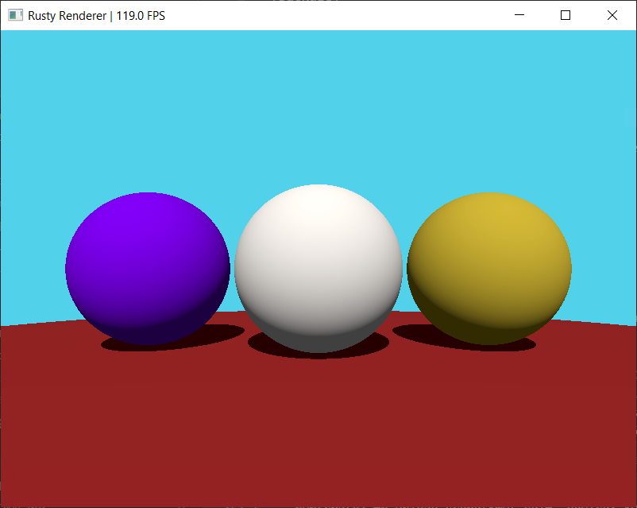

# rusty_renderer

An interactive GPU ray tracer written in Rust with [wgpu](https://wgpu.rs/) and WGSL. The GPU setup, resource management and rendering are written by hand: no game engine or rendering framework.

🚧 Work in progress.



## Why

A project to learn GPU programming from first principles: how a graphics API is structured, how work and data move between CPU and GPU, and how a ray tracer turns geometry and light into an image. Each layer is built and understood before the next one is added.

## Current features

- Ray tracing in a WGSL compute shader: camera rays, ray–sphere intersection, nearest-hit resolution
- Scene defined in Rust (spheres, materials, lights, sky) and uploaded to GPU buffers
- Multiple directional lights with colour and intensity, each casting its own shadows
- Lambertian shading with an ambient term
- Scene editing at runtime: add and remove spheres while the renderer is running
- Blender-style orbit camera with orbit, pan and zoom
- Window resizing and minimising handled without recreating the pipeline

## Technical highlights

- **Compute-shader ray tracing:** one GPU invocation per pixel writes to a storage texture; a separate fullscreen-triangle render pass presents it. The rendering algorithm is independent of the display code.
- **Explicit GPU resource management:** hand-written bind group and pipeline layouts, with resources grouped by update frequency: per frame (output image, camera) and per scene (spheres, materials, lights, scene settings).
- **Growable GPU storage buffers:** scene buffers grow with spare capacity when the scene grows, and the shader reads the real object counts, so unused capacity is never rendered.
- **CPU–GPU data layout:** Rust structs matched byte-for-byte to WGSL alignment rules, with sizes checked at compile time.
- **Type-safe scene references:** objects refer to materials through IDs that only the scene can create, so an object can never point at a missing material.
- **Linear-light pipeline:** all shading is done in linear space; colours picked in sRGB are converted on input, and sRGB encoding happens only when writing to the screen.
- **Quaternion orbit camera:** yaw about the world vertical axis and pitch about the camera's local axis, with no gimbal-lock singularity.
- **Modular architecture:** window and event handling, GPU context, ray tracer, display pass, camera and scene are separate modules.

## How a frame is rendered

```text
scene change ─► storage buffers (spheres, materials, lights) + scene settings uniform
camera update ─► camera uniform
                      │
compute pass:   one invocation per pixel traces a ray ─► storage texture (linear colour)
                      │
render pass:    fullscreen triangle reads the texture ─► window surface (sRGB)
                      │
present
```

## Controls

| Action | Input |
|---|---|
| Orbit | Middle mouse drag |
| Pan | Shift + middle mouse drag |
| Zoom | Mouse wheel |
| Reset camera | Space |
| Add a random sphere | Enter |
| Remove the last sphere | Backspace |

## Build and run

Requirements:
- Rust 1.85 or newer (the crate uses edition 2024)
- A GPU with DirectX 12 support

```
cargo run --release
```

The wgpu backend is currently set to DX12, so the renderer runs on Windows. wgpu also supports Vulkan and Metal; the backend is selected in `src/main.rs`.

## Project structure

| Module | Responsibility |
|---|---|
| `main.rs` | Event loop and GPU instance |
| `app.rs` | Window events and input handling |
| `state.rs` | Owns the per-window resources and coordinates each frame |
| `gpu.rs` | Surface, device, queue and swapchain configuration |
| `tracer.rs` | Compute pipeline, bind groups, camera and scene buffers |
| `display.rs` | Render pipeline that presents the traced image |
| `camera.rs` | Orbit camera and its GPU representation |
| `scene.rs` | Scene description (spheres, environment) and its GPU representation |
| `material.rs` | Materials and their GPU representation |
| `light.rs` | Lights and their GPU representation |
| `rng.rs` | Small random number generator |
| `fps.rs` | Frame-rate counter |
| `utils.rs` | Shared helpers |
| `shaders/` | WGSL compute and display shaders |

## Roadmap

- **Path tracing:** multiple bounces, progressive accumulation over frames, anti-aliasing and tone mapping
- **Materials:** diffuse, metal with roughness, glass with refraction, emissive surfaces
- **Lights:** point, spot and area lights, and environment lighting from HDR images
- **Triangle meshes** with per-object position and orientation
- **BVH acceleration structure** for models with hundreds of thousands of triangles
- **Model loading** (glTF)
- **Scene description file** and **export of finished renders** to image files

## License

MIT